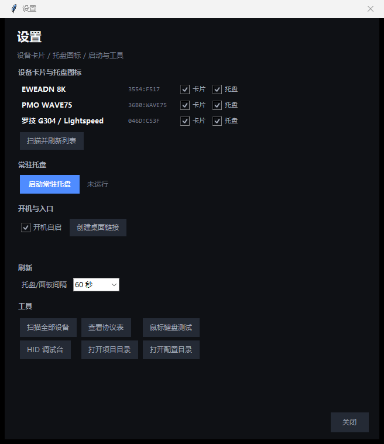
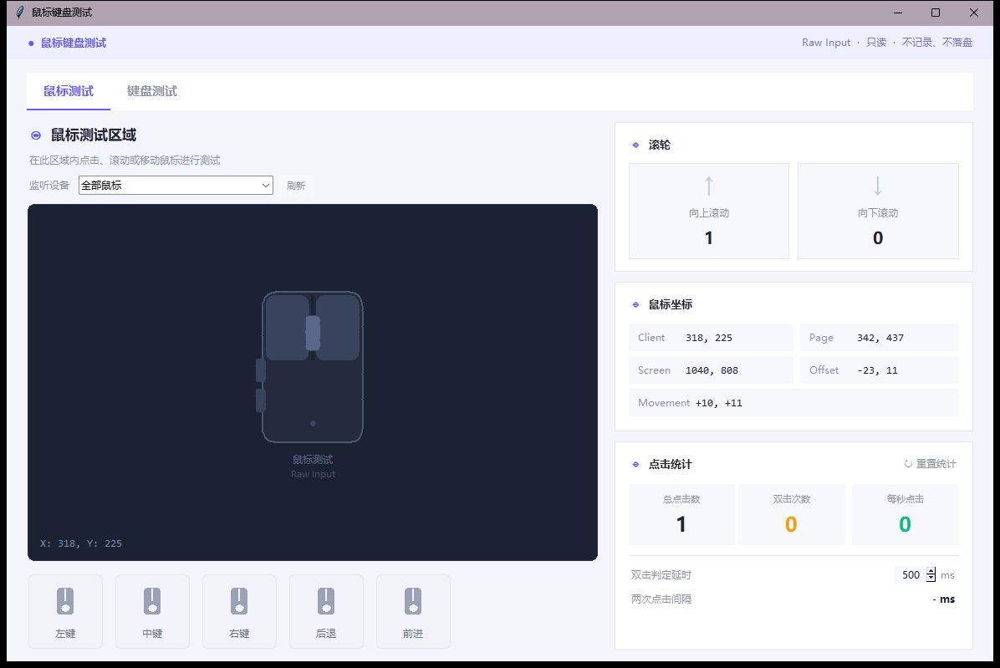
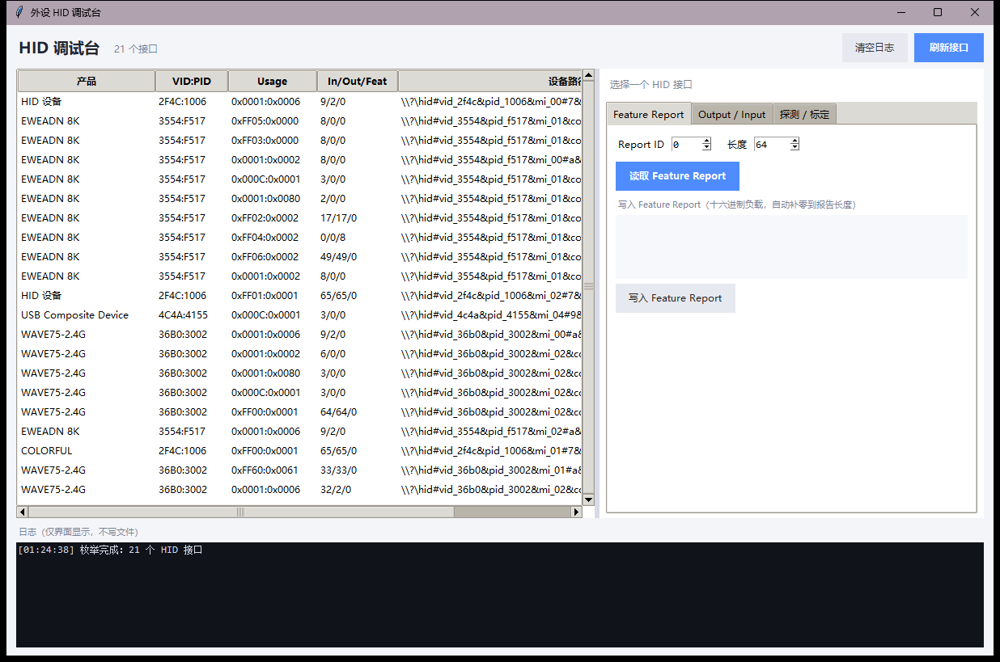

# Wireless HID Toolbox（2.4G 外设工具箱）

Windows 10/11 的 2.4G 无线外设电量与 HID 调试工具箱。纯 Python 标准库 +
`ctypes` + `tkinter`，运行时不依赖任何第三方库。

- **电量**：EWEADN 8K、PMO WAVE75、罗技 G304，以及协议表里的其他设备
- **主界面**：可选设备卡片、统一字段、托盘图标逐设备开关、最小化到托盘
- **托盘**：每台勾选的设备一个数字图标，点击打开/恢复面板
- **测试**：鼠标键盘测试，多设备切换监听、按键/移动/滚轮/坐标/点击统计
- **调试**：完整 HID 调试台（Feature / Output / Input / 探 ID / 手动标定）
- **系统集成**：开机自启、桌面入口、上次电量缓存
- **打包**：`main.py` 统一入口，可直接用 PyInstaller 打包成 exe




## 支持的设备与协议

| 协议 / 方案 | 识别方式 | 电量位置 |
|---|---|---|
| EWEADN 8K（本机） | `3554:F517`，`0xFF02`，17B | `[5]`，电压曲线 |
| PMO WAVE75（本机） | `36B0:3002/3009`，`0xFF60` | `[8]`，RDR `AA 30` |
| 罗技 G304 / HID++ | `046D:C53F`，HID++ 2.0 | `0x1000/0x1004` |
| ATK / VXE / VGN 协议 1 | `0xFF02`，17B | `[6]`，`0x55` 校验 |
| ATK / VXE 协议 2 | `0xFF05`，64B | `[7]` |
| Dareu A950 / VXE / Imecoo | 同 ATK 1 | `[6]` |
| MCHOSE V9 Turbo / Turbo+ | `0xFF90`，`55 65 01` | `[2]` |
| MCHOSE A5 / AX5 | `0x2023`，Feature 65，MI_02 | `[8]`，cmd `0x83` |
| MCHOSE A7 compatible | `5253:1021`，Feature `0x11` | payload `[9]` |
| MCHOSE gmouse | `0xFF01`，`55 30 A5 0B 2E` | 回复 `AA 30` 后 `+8` |
| MCHOSE Z75S | `258A:01BB`，20B | `[5]` |
| ATK N9V2 耳机 | `0xFF90`，`55 65 01` | `[2]` |
| XIBERIA T7 | `36F9:*`，`0xFF00` | `[3]` |
| Rapoo VT3S | `24AE:1411`，主动上报 | `[8]` |
| Endgame Gear | Feature `0xA1` | `[16]` |
| VAXEE / ZYGEN | Feature `0x0E` | `[5] × 5%` |
| Nordic nRF | Feature `0x05` | `[9]` |
| DARKRIM / 杰理 | `3654:6901`，JL_RCSP | TLV `0x01` |
| ZOWIE DW | `04A5:800A`，双接口 | 电压插值（实验） |
| 标准 HID | Battery Strength Usage | Feature 值 |
| 抓包协议 | `captured.json` | 任意偏移 |

> EWEADN、PMO、罗技 G304 在本机实测；其他协议来自公开协议文档/仓库的移植，
> 已做单元测试，但建议接上设备后用 `generic_scan.py --list` / `--scan` 验证。
> 只发送只读查询，不写设备配置；未知 opcode 不要盲目爆破。

## 快速开始（源码）

```bat
cd D:\zh\DeepSeekHarness\HUB\Wireless-HID-Toolbox

python main.py                    :: 主界面（默认）
python main.py --tool tray        :: 托盘
python main.py --tool mouse-test  :: 鼠标键盘测试
python main.py --tool hid-debug   :: HID 调试台

python my_devices.py --once       :: 两台本机设备读一次
python my_devices.py --scan       :: 所有已收录协议
python generic_scan.py --list     :: 看本机设备命中了哪些协议
```

源码运行也可以直接双击 `启动面板.cmd` / `启动托盘.cmd`。

## 打包成 exe

```bat
python -m pip install -r requirements-build.txt
build_exe.bat
```

产物：

```text
dist\WirelessHIDToolbox.exe
```

- **双击 exe 直接打开主界面**；
- 设置里的鼠标键盘测试、HID 调试台、托盘通过 `exe --tool ...` 打开，
  不依赖外部 `.py` 文件；
- 开机自启/桌面入口在 exe 模式下指向 exe 本身；
- PyInstaller 只用于打包，运行程序本身仍然零第三方依赖。

## 主界面

- 卡片按设备动态生成，不再写死；右上角 **⚙ 设置** 逐设备选择
- 所有卡片统一字段：**连接 / 充电 / 电压 / 数据源**
- 大号百分比 + 进度条；休眠时显示灰色上次电量 + 上次更新时间
- 底部：**立即刷新 / 自动刷新 / 常驻托盘 / 最小化到托盘**
- 「立即刷新」采用并行扫描 + 短超时，面板和托盘不会互相长时间阻塞
- 标题栏最小化也会缩到托盘；托盘未运行时自动先启动

### 设置窗口

- 设备卡片 / 托盘图标：每台设备独立勾选
- 扫描并刷新设备列表
- 常驻托盘：启动 / 退出
- 开机自启、创建桌面链接
- 刷新间隔：30 秒–30 分钟
- 工具：扫描全部、协议表、鼠标键盘测试、HID 调试台、项目目录、配置目录

## 托盘常驻

```bat
python tray_app.py --status
python tray_app.py --debug
python tray_app.py --quit
```

- 每台勾选「托盘」的设备一个图标，数字即电量
- 绿 ≥60 / 黄 30–59 / 红 <30；灰色数字表示休眠缓存
- **点击图标打开/恢复面板**（左键/右键均可），同时刷新一次
- tooltip：`设备名：电量%（更新时间）`
- 低 CPU：`SetTimer` 驱动，默认 60 秒
- 退出走 `WM_DESTROY -> PostQuitMessage`，不留僵尸进程

## 鼠标键盘测试

```bat
python mouse_test_gui.py
python mouse_test_gui.py --demo
```



- 鼠标页 / 键盘页各自有「监听设备」下拉框
- 系统里同类设备 **大于 1 台** 时出现，可切换「全部」或指定设备；
  点「刷新」重新枚举
- 切换设备会重启 Raw Input 监听并清空旧事件
- 鼠标：五个按键、滚轮、坐标、点击统计、双击判定
- 键盘：按键名、VK、扫描码、最近按键
- 只显示，不记录、不落盘

## HID 调试台

```bat
python app.py
```



- 枚举 HID 接口、Feature/Output/Input 报告
- 探测 Report ID 0..15
- 手动标定：Report ID + 字节下标 + 倍率 + 偏移，保存 `calibration.json`
- 日志只在窗口里显示，不写文件

## 开机自启 / 桌面链接

- 开机自启：启动文件夹 `电量托盘.lnk`
  - 源码版目标 `pythonw.exe tray_app.py`
  - exe 版目标 `WirelessHIDToolbox.exe --tool tray`
  - 任务管理器「启动」里可见/可禁用
- 桌面入口：
  - 源码版：项目目录 symlink/junction + `启动面板.cmd` symlink/hardlink
  - exe 版：`外设电量.lnk` 指向 exe
- 配置读取真实状态，不自动改用户系统设置

## 配置 / 缓存

```text
%APPDATA%\ExtBatteryTray\config.json
%APPDATA%\ExtBatteryTray\last_<key>.json
```

`config.json` 的 `devices`：

```json
"devices": {
  "3554:F517": {"name": "EWEADN 8K", "show": true, "tray": true, "order": 10},
  "36B0:WAVE75": {"name": "PMO WAVE75", "show": true, "tray": true, "order": 20},
  "046D:C53F": {"name": "罗技 G304 / Lightspeed", "show": true, "tray": true, "order": 30}
}
```

`show` = 面板卡片，`tray` = 托盘图标。运行期还会写
`tray_pid.txt`、`panel_hwnd.txt`、`panel_show.req`，都不是日志。

## 命令行

```bat
python my_devices.py --once
python my_devices.py --json
python my_devices.py --watch 30
python my_devices.py --scan
python my_devices.py --list
python my_devices.py --install
python my_devices.py --panel

python generic_scan.py
python generic_scan.py --list
python generic_scan.py --protocols
python generic_scan.py --json
python generic_scan.py --watch 60

python tray_app.py --status
python tray_app.py --quit
```

## 实现要点

- **HID 访问**：`setupapi` / `hid.dll` / `kernel32`，读用独立 overlapped 句柄
- **多厂商协议**：协议表 + 标准 HID + 抓包协议；按 VID/PID/usage 匹配
- **并行扫描**：各设备分组并行读；面板用 `fast=True` 短超时，先展示缓存
- **跨进程锁**：键盘会话 `Local\ExtBatteryHidReadLock`；整轮扫描
  `Local\ExtBatteryHidScanLock`（短等待）
- **上次电量**：成功读取写 `last_state`；休眠时回退缓存
- **面板恢复**：隐藏时写 HWND + 显示请求文件，托盘点击恢复，不重复开窗
- **不写日志**：默认不产生日志文件，`--debug` 只打印到控制台

## 测试

```bat
python -m unittest discover -s tests -v
```

共 34 个用例：

- 8 个鼠标协议/电压曲线
- 5 个 Raw Input 事件解析
- 4 个 PMO 键盘
- 12 个多厂商协议帧/校验/解析
- 5 个设备目录/快照字段

## 验收自检（本机实测）

| 项目 | 结果 |
|---|---|
| `my_devices.py --once` | 鼠标 84%（缓存/唤醒后即时）+ 键盘 58% |
| 主界面 | EWEADN / PMO / 罗技 G304 三张卡片，字段统一 |
| 每设备托盘开关 | G304 关→`NIM_DELETE`，开→`NIM_ADD` |
| 最小化到托盘 | 托盘未启动会先启动；点击托盘图标恢复 |
| 托盘连续启停 3 次 | 3/3 成功，最终 `pythonw` 进程数 = 0 |
| 开机自启 | `电量托盘.lnk`，任务管理器状态「已启用」 |
| 桌面入口 | 源码版 symlink，exe 版 `.lnk` |
| 空闲 CPU | 10 秒内 `0.000` 秒 |

## 限制

- 仅 Windows 10/11；依赖 Win32 HID / Raw Input
- 未知厂商协议仍需抓包确认；加密/私有握手需要逆向
- ZOWIE 双接口、MCHOSE A5/A7/gmouse 等尚未逐台真机验证
- 不做设置写入、不改 DPI / 灯效 / 按键，只读查询

## 致谢

HID 访问层与托盘/快捷方式基础模块来自
[2.4G-battery-viewer](../2.4G-battery-viewer)；托盘图标、上次电量缓存、
`--list/--install/--panel` 等交互参考了
[EZ2.4G](https://github.com/Ap0LoG1zE/EZ2.4G)（MIT）。

多厂商协议参数来自公开资料：
[sdparklab/Voltide](https://github.com/sdparklab/Voltide)（MIT）、
[aliezzzz/mchose-battery](https://github.com/aliezzzz/mchose-battery)（MIT）、
[Techxey/atk-mouse-battery](https://github.com/Techxey/atk-mouse-battery)、
[HifumiDaisuki01/MchoseBatteryTray](https://github.com/HifumiDaisuki01/MchoseBatteryTray)
以及 `EZ2.4G/c/PROTOCOLS.md` 的整理。协议部分仅供学习与个人使用。
