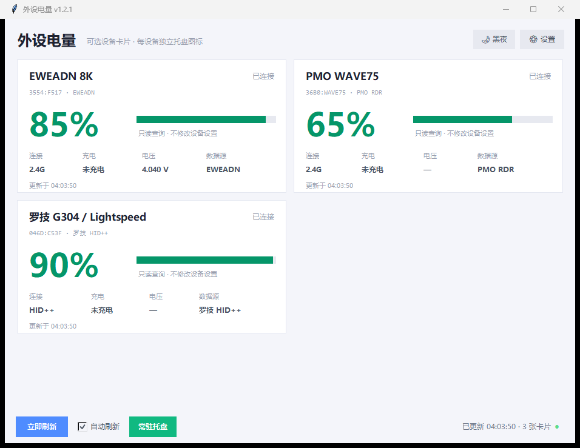
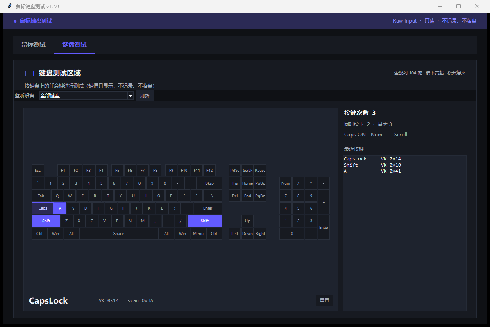

# Wireless HID Toolbox（2.4G 外设工具箱）

当前版本：**v1.14.5**（更新记录见 [CHANGELOG.md](CHANGELOG.md)）

Windows 10/11 的 2.4G 无线外设电量与 HID 调试工具箱。纯 Python 标准库 +
`ctypes` + `tkinter`，运行时不依赖任何第三方库。

- **电量**：EWEADN 8K、PMO WAVE75、罗技 G304、魔声 AI 垂直鼠标，以及协议表里的其他设备
- **设备目录**：魔声 AI 垂直鼠标（`248A:60AB`）已登记，可在面板/托盘/测试面板显示，
  并通过 `0xFF91` 私有口读取电量（实验性解析，见「支持的设备与协议」）；
  英菲克 F15 无线鼠标（`1EA7:0064`）与狼蛛 S99 三模键盘（`1A2C:7FFF`）
  也已登记，当前只显示占位、不显示电量
- **语音解码（纯本地）**：魔声 AI 垂直鼠标长按语音键时，`0xFF91` 回传加扰 ADPCM，
  `aimouse_voice.decode_frames_local()` 可完全本地还原成 16kHz WAV，
  不需要云端、官方驱动或剪贴板（见「语音解码」）
- **语音输入（可选）**：设置里开启「语音输入到焦点」后，识别文字会自动键入
  当前光标所在的输入框（任意程序），实现真正的语音输入（见「语音输入」）
- **语音窗口**：魔声 AI 垂直鼠标卡片上的「🎤 语音」按钮，支持监测录音、列表播放/删除、
  实时转文字与参数设置；松开语音键立即收尾出结果，识别不重复跑（见「语音窗口」）
- **转文字（默认纯本地）**：`local_only=1` 时只用本地 Vosk，完全不联网、不读剪贴板；
  设为 0 后按「Vosk → 云端 ASR → 剪贴板桥接」自动降级；
  另支持词表约束与 1.3GB 大模型（见「语音窗口」）
- **主界面**：可选设备卡片、统一字段、托盘图标逐设备开关、最小化到托盘；
  点击卡片上的设备名即复制到剪贴板，短暂显示「✓ 已复制」后恢复
- **托盘**：每台勾选的设备一个数字图标，点击打开/恢复面板
- **测试**：鼠标键盘测试，多设备切换监听、按键/移动/滚轮/坐标/点击统计
- **调试**：完整 HID 调试台（Feature / Output / Input / 探 ID / 手动标定）
- **UI 约定**：所有纵向/横向滚动条仅在内容超出对应可视区域时显示
  （`ui_common.AutoScrollbar`），内容未超出时隐藏、不占位
- **系统集成**：开机自启、桌面入口、上次电量缓存
- **打包**：`main.py` 统一入口，onefile / onedir 可选

## 文档导航

- [更新记录](CHANGELOG.md)
- [能力总览](docs/CAPABILITIES.md)：一页速查全部能力、依赖矩阵、参数表与验证命令
- [诊断工具](tools/README.md)：抓 0xFF91 帧序列、独立验证解码链路
- [打包说明](docs/PACKAGING.md)：onefile 默认、onedir 选择、产物与排错
- [主题说明](docs/THEME.md)：白天/黑夜配色与新增颜色约定
- [测试说明](docs/TESTING.md)：自动化覆盖、GUI 手动验收清单
- [设备配置](docs/DEVICE_CONFIG.md)：设备类型、删除/恢复、配置字段
- [AiMouse 语音链路逆向笔记](docs/AiMouse-RE-Notes.md)：帧结构、反汇编证据、
  云端 ASR 协议、配对实验与未解决问题





## 支持的设备与协议

| 协议 / 方案 | 识别方式 | 电量位置 |
| --- | --- | --- |
| EWEADN 8K（本机） | `3554:F517`，`0xFF02`，17B | `[5]`，电压曲线 |
| PMO WAVE75（本机） | `36B0:3002/3009`，`0xFF60` | `[8]`，RDR `AA 30` |
| 罗技 G304 / HID++ | `046D:C53F`，HID++ 2.0 | `0x1000/0x1004` |
| ATK / VXE / VGN 协议 1 | `0xFF02`，17B | `[6]`，`0x55` 校验 |
| ATK / VXE 协议 2 | `0xFF05`，64B | `[7]` |
| Dareu A950 / VXE / Imecoo | 同 ATK 1 | `[6]` |
| MCHOSE V9 Turbo / Turbo+ | `0xFF90`，`55 65 01` | `[2]` |
| MCHOSE A5 / AX5 | `0x2023`，Feature 65，MI_02 | `[8]`，cmd `0x83` |
| MCHOSE A7 compatible | `5253:1021`，Feature `0x11` | payload `[9]` |
| MCHOSE gmouse | `0xFF01`，`55 30 A5 0B 2E` | 回复 `AA 30` 后 `+8` |
| MCHOSE Z75S | `258A:01BB`，20B | `[5]` |
| ATK N9V2 耳机 | `0xFF90`，`55 65 01` | `[2]` |
| XIBERIA T7 | `36F9:*`，`0xFF00` | `[3]` |
| Rapoo VT3S | `24AE:1411`，主动上报 | `[8]` |
| Endgame Gear | Feature `0xA1` | `[16]` |
| VAXEE / ZYGEN | Feature `0x0E` | `[5] × 5%` |
| Nordic nRF | Feature `0x05` | `[9]` |
| DARKRIM / 杰理 | `3654:6901`，JL_RCSP | TLV `0x01` |
| ZOWIE DW | `04A5:800A`，双接口 | 电压插值（实验） |
| 标准 HID | Battery Strength Usage | Feature 值 |
| 魔声 AI 垂直鼠标（本机） | `248A:60AB`，私有 `0xFF91` 主动上报 | `[5]`，实验性（约 2.5 秒一帧） |
| 抓包协议 | `captured.json` | 任意偏移 |

> 魔声 AI 垂直鼠标 的 `0xFF91` 接口会主动上报两种帧：带电量帧
> `0C 4D ?? 69 00 <电量> 04 01 00 4C`（偏移 5 为百分比）和不带电量的心跳帧
> `0C 4D 05 67 00 4C ...`（已排除，避免误报 76%）。当前按用户实测约 100%
> 校准，属实验性解析，只在 `248A:60AB` 上启用；休眠时回退到上次缓存。
>
> 英菲克 F15 无线鼠标（`1EA7:0064`，VID `0x1EA7` SHARKOON / PID `0x0064`）与
> 狼蛛 S99 三模键盘（`1A2C:7FFF`，VID `0x1A2C` China Resource Semico /
> PID `0x7FFF`，产品名 `2.4G Wireless Device`）已登记到设备目录，面板、托盘和
> 测试面板都能按名称/类型识别。两者尚未收录私有电量协议，HID 在线时卡片显示
> 「在线 · 无电量协议」和 `--`（不会误报「未连接」）；若设备暴露标准
> Battery Strength Usage 会自动读到，否则需抓包确认报文后写入 `captured.json`
> 或新增协议读取函数（见「设备配置」）。
>
> EWEADN、PMO、罗技 G304、魔声 AI 垂直鼠标 在本机实测；其他协议来自公开协议文档/仓库的移植，
> 已做单元测试，但建议接上设备后用 `generic_scan.py --list` / `--scan` 验证。
> 只发送只读查询，不写设备配置；未知 opcode 不要盲目爆破。

## 快速开始（源码）

```bat
cd D:\zh\DeepSeekHarness\HUB\Wireless-HID-Toolbox

python main.py                    :: 主界面（默认）
python main.py --version          :: 版本号
python main.py --tool tray        :: 托盘
python main.py --tool mouse-test  :: 鼠标键盘测试
python main.py --tool hid-debug   :: HID 调试台

python my_devices.py --once       :: 两台本机设备读一次
python my_devices.py --scan       :: 所有已收录协议
python generic_scan.py --list     :: 看本机设备命中了哪些协议
```

源码运行也可以直接双击 `启动面板.cmd` / `启动托盘.cmd`。

## 打包成 exe

```bat
python -m pip install -r requirements-build.txt

:: 默认：onefile 单文件
build_exe.bat

:: 选择文件夹模式
build_exe.bat onedir

:: 显式选择单文件
build_exe.bat onefile
```

也可以不带参数运行 `build_exe.bat`，按提示选择 `[1] onefile` 或 `[2] onedir`。

产物：

```text
onefile: dist\WirelessHIDToolbox.exe
onedir:  dist\WirelessHIDToolbox\WirelessHIDToolbox.exe
```

- **默认 onefile**，分发只需要一个 exe；首次启动会解压到临时目录，稍慢
- onedir 文件夹模式启动更快，分发时把整个 `dist\WirelessHIDToolbox` 一起打包
- **双击 exe 直接打开主界面**；
- 设置里的鼠标键盘测试、HID 调试台、托盘通过 `exe --tool ...` 打开，
  不依赖外部 `.py` 文件；
- 开机自启/桌面入口在 exe 模式下指向 exe 本身；
- 打包启用 `--optimize 2`、无用的标准库排除、`app.ico` 图标和
  `version_info.txt` 版本资源；
- PyInstaller 只用于打包，运行程序本身仍然零第三方依赖。

更完整的模式选择、产物与常见问题见 [docs/PACKAGING.md](docs/PACKAGING.md)。

## 主界面

- 卡片按设备动态生成，不再写死；右上角 **⚙ 设置** 逐设备选择
- 所有卡片统一字段：**连接 / 充电 / 电压 / 数据源**
- 大号百分比 + 进度条；休眠时显示灰色上次电量 + 上次更新时间
- 底部：**立即刷新 / 自动刷新 / 常驻托盘**
- 右上角：**☀ 白天 / 🌙 黑夜** 主题切换，配置持久化；已打开的工具窗口自动跟随
  （实现与配色约定见 [docs/THEME.md](docs/THEME.md)）
- ⚙ 设置 → **标题栏按钮**：
  - 最小化（-）：最小化到托盘 / 正常收起窗口（任务栏仍保留应用图标）
  - 关闭（×）：仅关闭主界面 / 关闭所有可见窗口 / 完全退出应用（含托盘）
- 完全退出会弹窗确认，并结束本应用打开的测试/调试工具与托盘
- **每个界面**的 × 都读取同一设置：设置窗口、鼠标键盘测试、HID 调试台同样生效
- 托盘未运行且 × 不是“完全退出”时，会先询问是否启动常驻托盘
- 没有托盘且关闭的是最后一个应用窗口时，视为完全退出
- 标题栏最小化按设置执行；缩到托盘前先标记状态并加启动锁，不会重复启动托盘/重复图标

### 设置窗口

- 设备卡片 / 托盘图标：每台设备独立勾选
- 设备类型：鼠标 / 键盘下拉选择，写入设备配置
- 删除此设备；「恢复已删除」可找回，扫描不会自动恢复已删设备
- 扫描并刷新设备列表
- 常驻托盘：启动 / 退出
- 标题栏按钮：最小化（-）/ 关闭（×）行为
- 开机自启、创建桌面链接
- 刷新间隔：30 秒–30 分钟
- 工具：扫描全部、协议表、鼠标键盘测试、HID 调试台、项目目录、配置目录

设备类型、删除/恢复与配置字段见 [docs/DEVICE_CONFIG.md](docs/DEVICE_CONFIG.md)。

## 托盘常驻

```bat
python tray_app.py --status
python tray_app.py --debug
python tray_app.py --quit
```

- 每台勾选「托盘」的设备一个图标，数字即电量
- 绿 ≥60 / 黄 30–59 / 红 <30；灰色数字表示休眠缓存
- **点击图标打开/恢复面板**（左键/右键均可），同时刷新一次
- tooltip：`设备名：电量%（更新时间）`
- 低 CPU：`SetTimer` 驱动，默认 60 秒
- 退出走 `WM_DESTROY -> PostQuitMessage`，不留僵尸进程

## 鼠标键盘测试

```bat
python mouse_test_gui.py
python mouse_test_gui.py --demo
```


- 鼠标页 / 键盘页各自有「监听设备」下拉框
- 按物理设备（VID:PID）归入一个主类别，接收器的 Consumer/键盘集合
  不会串到鼠标列表，也不会把鼠标集合串到键盘列表
- 系统里同类设备 **大于 1 台** 时出现下拉框，可切换「全部」或指定设备；
  点「刷新」重新枚举
- 切换设备会重启 Raw Input 监听并清空旧事件
- 鼠标：通用 5 键示意图、每键计数/按下状态、滚轮、坐标、点击统计、双击判定
  - **回报率**：当前/峰值/平均 Hz（基于 Raw Input 移动报告）
  - 可选 **绘制轨迹**，统计轨迹点数
  - 示意图目前不按型号自动变形；不同型号的 DPI/宏键通常不走标准 Raw Input，
    需要厂商协议才能单独识别，因此不伪造额外按键
- 键盘：**104 键全配列**（含功能行、导航区、数字小键盘）
  - 按下亮起、松开熄灭；支持同时按下/最大 rollover、Caps/Num/Scroll 锁定
  - 显示按键名、VK、扫描码、最近按键、按键次数，可一键重置
- 只显示，不记录、不落盘



## 语音解码（魔声 AI 垂直鼠标）· 纯本地

`0xFF91` 私有口除了电量，还会在长按语音键时回传**加扰的 IMA ADPCM 压缩语音**。
`aimouse_voice.py` 可**完全本地**还原成 16kHz / 16bit 单声道 WAV ——
不需要云端 ASR、不需要官方驱动运行、不需要读剪贴板：

```python
import aimouse_voice as av

frames = [...]                              # 从 0xFF91 读到的 33 字节帧
samples = av.decode_frames_local(frames)    # XOR 还原 + 跨帧连续 IMA
av.save_wav("voice.wav", av.normalize(samples))
```

帧结构（反汇编 `AiMouse.exe` 0x4E6890 + Frida 逐帧配对确认）：

| 偏移 | 内容 |
| --- | --- |
| `[0]` | `0x1B` 帧标识 |
| `[1:4]` | **设备侧状态**，不是解码器状态（不参与解码） |
| `[4]` | `0xBE` 保留字节 |
| `[5:33]` | 28 字节加扰数据，需先按位置 XOR `av.ADPCM_XOR_MASK` |

解码要点（已封装在 `decode_frames_local`）：

1. 每帧 28 字节按位置 XOR 固定 28B 密钥（966 帧配对 100% 恒定）；
2. `predictor=0 / step_index=0` 起步，**跨帧连续不重置**（实测帧间状态差为 0）；
3. 标准 IMA，**低 4 位先**，每帧 56 样本。

端到端实测（1528 帧 / 5.35s）：RMS **8694**、相邻差中位 **521**、饱和 **0.6%**，
与官方解码 PCM 一致；Vosk 离线可识别出「语音输入…」。
完整逆向过程见 [AiMouse 语音链路逆向笔记](docs/AiMouse-RE-Notes.md)。

> `decode_frame()` / `decode_frames()` 保留为未加扰流的旧实现（每帧独立重置），
> 真实设备请用 `decode_frames_local()`。

**降噪建议**：4-bit ADPCM 量化噪声接近白噪声，理论 SNR 约 20dB。
用 `decode_frames_local()` 还原后波形已与官方一致，通常只需
`av.highpass()` 轻度高通，**不要重度降噪** —— 谱减产生的"音乐噪声"
是非自然伪影，反而更容易让语音识别出错。

> 官方驱动的解码器也不做本地降噪，直接把 PCM 发往云端 ASR，原因就在这里。

## 语音窗口（魔声 AI 垂直鼠标 卡片）

主界面 魔声 AI 垂直鼠标 卡片右上角的 **🎤 语音** 按钮打开语音窗口：

- **开始监测 / 结束监测**：长按鼠标语音键开始录音，松开自动保存一条 WAV
- **录音列表**：点击选中，支持 **播放 / 停止 / 删除 / 转文字**
- **实时区域**：录音中显示音量条与实时识别文字
- **设置（⚙）**：每个参数一行，含参数名、中文描述、输入框与左右加减按钮，
  **点「保存」才生效**

可调参数（存放于 `%APPDATA%\ExtBatteryTray\voice_config.json`）：

| 参数 | 说明 | 默认 |
| --- | --- | --- |
| `highpass` | 高通截止频率（Hz）；0 关闭 | 150 |
| `peak` | 归一化峰值；越小越不易削波 | 26000 |
| `denoise` | 降噪强度 0–100（需 noisereduce） | 0 |
| `auto_transcribe` | 录制结束后自动识别（1/0） | 1 |
| `max_seconds` | 单次最长录制（秒） | 30 |
| `save_dir` | 音频保存目录 | `%APPDATA%\ExtBatteryTray\voice` |
| `model_dir` | Vosk 中文模型目录 | `…\models\vosk-model-small-cn-0.22` |
| `asr_backend` | 识别后端：0 自动（本地优先）/ 1 Vosk / 2 剪贴板 / 3 云端 | 0 |
| `local_only` | 纯本地模式：1=只用本地 Vosk，完全不联网/不读剪贴板 | **1** |
| `asr_grammar` | 识别词表（可选），逗号分隔；留空=通用识别 | 空 |
| `stream_asr` | 流式转文字：1=边说边转；0=松开语音键后整段识别一次 | **1** |
| `voice_typing` | 语音输入到焦点：1=识别后把文字键入当前焦点输入框 | 0 |

### 响应与收尾

- 「长按抬起」帧直接触发收尾（留 150ms 收尾部音频帧），**不再等待设备补发
  `0x05/0x63` 状态帧**，松开即出结果；音频中断超时 0.6 秒兜底
- Vosk 模型按目录全局缓存并在开始监测时后台预热；设置保存/重开监测不重复加载
- 流式识别跑过就不再补跑文件识别（原先一段音频会识别两遍）
- 音量条与部分结果约 10Hz 刷新，事件队列单轮上限 120 条，避免音频帧洪泛
  把收尾事件饿死

### 转文字模式（`stream_asr`）

设置里「流式转文字」默认 **1**：

| 值 | 行为 |
| --- | --- |
| **1（默认）** | **边说边转**：录音期间实时显示部分识别结果，松开按键得到最终结果 |
| 0 | **整段识别**：录音期间完全不加载识别器，松开按键、保存 WAV 后对整段音频识别一次 |

**流式与整段共用同一套解码**：`LocalStreamDecoder`（XOR 解扰 + 跨帧连续 IMA），
保证流式喂给 Vosk 的不是未解扰噪声；若流式仍没出文字且自动转文字开着，
会自动回退整段识别一次。

**输出空格规整**：Vosk 中文模型默认按词用空格拼接，界面与语音输入统一去掉
中文词之间的空格（「测试 语音 输入 一二三」→「测试语音输入一二三」），
英文单词之间的空格保留（「hello world」原样）；流式、整段、云端、剪贴板
所有来源一致。

整段模式受 `auto_transcribe` 控制（默认开）。两种模式的结果都显示在
「识别文字」区，并在 `voice_typing=1` 时键入焦点输入框；
顶部徽标会显示 `实时转写` 或 `整段转写`。

### 语音输入（可选，默认关闭）

设置里把 **「语音输入到焦点」设为 1** 后：

1. **先点击目标输入框**（浏览器、微信、记事本等任意程序），让光标停在那里
2. 保持语音窗口在后台，**按住鼠标语音键说话，松开**
3. 识别结果会自动键入刚才那个输入框，同时仍显示在窗口的「识别文字」区域

实现要点（`voice_typing.py`，纯 ctypes、零第三方依赖）：

- 窗口每 0.4 秒记录最近一个**非本进程**的前台窗口与焦点控件；
  桌面、任务栏、锁屏等系统窗口会被排除，避免误键入
- 中文通过 `SendInput` 的 `KEYEVENTF_UNICODE` 逐字符发送，
  非 BMP 字符（emoji）自动拆成 UTF-16 surrogate 对
- 若目标窗口已不在前台，先尝试 `SetForegroundWindow` 恢复，失败则跳过并提示
- 开关默认 **0（关闭）**；未检测到外部输入框时只显示、不键入；
  实时中间结果只显示，只有最终识别结果才会键入
- 开启后顶部徽标会追加 `· ⌨语音输入`

### 识别后端（自动降级）

**默认 `local_only=1`：窗口只走本地 Vosk，完全不联网、不读剪贴板、不依赖官方驱动。**
窗口顶部绿色徽标会实时显示当前模式（如 `🟢 纯本地解码 · 仅本地 Vosk · 词表限制`），
实时区域下方还会显示解码方式、识别后端与当前模型名。

把 `local_only` 设为 0 后，按 `asr_backend` 选择后端；「0 自动」按
**Vosk（本地）→ 云端 ASR → 剪贴板桥接** 依次尝试，任一环节出结果即停止：

| 后端 | 依赖 | 说明 |
| --- | --- | --- |
| 云端 ASR | `websockets`（可选） | `aimouse_cloud_asr.py` 实现官方 `asr.miclink.net/ws` 协议；凭据可配置，或只读从驱动进程内存取 |
| Vosk | `vosk` + 中文模型 | 本地离线；小模型对 4-bit ADPCM 噪声鲁棒性有限 |
| 剪贴板桥接 | 无 | 官方驱动松开语音键后会把识别文字写入剪贴板，窗口监听序列号变化取回；仅录制后可用 |

**识别词表（可选）**：在设置里填 `测试,语音,输入,一二三` 这类候选词，
Vosk 会启用 grammar 约束。适合固定命令/口令场景。
注意：**只有 small 系列模型支持词表**，完整版大模型会忽略它（界面会提示「词表不适用」）。

**四组实测对比**（`local_decoded.wav`，用户说「测试语音输入一二三」）：

| 配置 | 识别结果 |
| --- | --- |
| 小模型 通用 | 「此事 语音 输入 与 啊 上」 |
| 小模型 + 词表 | **「测试 语音 输入 一二三」** |
| 大模型 通用 | **「是 语音 输入 一 二 三」** |
| 大模型 + 词表 | 「是 语音 输入 一 二 三」（词表被忽略） |

`vosk-model-cn-0.22` 大模型（1.3GB）已可下载安装；装好后把设置里的
`model_dir` 指向 `…\models\vosk-model-cn-0.22` 即可，界面会检测并提示。
自由说话推荐大模型通用，固定命令推荐小模型 + 词表。

三者都不可用时只保存音频，录制、播放、删除、设置不受影响。
项目主体仍保持零第三方运行时依赖。

```bat
python -m pip install vosk websockets
```

独立验证解码链路（零依赖）：

```bat
python tools\verify_local_decode.py
```

Vosk 中文小模型（约 42MB）解压到 `model_dir`：

```text
https://alphacephei.com/vosk/models/vosk-model-small-cn-0.22.zip
```

## HID 调试台

```bat
python app.py
```


- 枚举 HID 接口、Feature/Output/Input 报告
- 探测 Report ID 0..15
- 手动标定：Report ID + 字节下标 + 倍率 + 偏移，保存 `calibration.json`
- 日志只在窗口里显示，不写文件

## 开机自启 / 桌面链接

- 开机自启：启动文件夹 `电量托盘.lnk`
  - 源码版目标 `pythonw.exe tray_app.py`
  - exe 版目标 `WirelessHIDToolbox.exe --tool tray`
  - 任务管理器「启动」里可见/可禁用
- 桌面入口：
  - 源码版：项目目录 symlink/junction + `启动面板.cmd` symlink/hardlink
  - exe 版：`外设电量.lnk` 指向 exe
- 配置读取真实状态，不自动改用户系统设置

## 配置 / 缓存

```text
%APPDATA%\ExtBatteryTray\config.json
%APPDATA%\ExtBatteryTray\last_<key>.json
```

`config.json` 的 `devices`：

```json
"devices": {
  "3554:F517": {"name": "EWEADN 8K", "show": true, "tray": true, "order": 10},
  "36B0:WAVE75": {"name": "PMO WAVE75", "show": true, "tray": true, "order": 20},
  "248A:60AB": {"name": "魔声 AI 垂直鼠标", "show": true, "tray": true, "order": 25},
  "1EA7:0064": {"name": "英菲克 F15 无线鼠标", "show": true, "tray": true, "order": 30},
  "1A2C:7FFF": {"name": "狼蛛 S99 三模键盘", "show": true, "tray": true, "order": 40},
  "046D:C53F": {"name": "罗技 G304 / Lightspeed", "show": true, "tray": true, "order": 50}
}
```

`show` = 面板卡片，`tray` = 托盘图标。运行期还会写
`tray_pid.txt`、`panel_hwnd.txt`、`panel_show.req`，都不是日志。

## 命令行

```bat
python my_devices.py --once
python my_devices.py --json
python my_devices.py --watch 30
python my_devices.py --scan
python my_devices.py --list
python my_devices.py --install
python my_devices.py --panel

python generic_scan.py
python generic_scan.py --list
python generic_scan.py --protocols
python generic_scan.py --json
python generic_scan.py --watch 60

python tray_app.py --status
python tray_app.py --quit
```

## 实现要点

- **HID 访问**：`setupapi` / `hid.dll` / `kernel32`，读用独立 overlapped 句柄
- **多厂商协议**：协议表 + 标准 HID + 抓包协议；按 VID/PID/usage 匹配
- **并行扫描**：各设备分组并行读；面板用 `fast=True` 短超时，先展示缓存
- **跨进程锁**：键盘会话 `Local\ExtBatteryHidReadLock`；整轮扫描
  `Local\ExtBatteryHidScanLock`（短等待）
- **上次电量**：成功读取写 `last_state`；休眠时回退缓存
- **面板恢复**：隐藏时写 HWND + 显示请求文件，托盘点击恢复，不重复开窗
- **不写日志**：默认不产生日志文件，`--debug` 只打印到控制台

## 测试

```bat
python -m unittest discover -s tests -v
```

共 **205** 个用例：

- 8 个鼠标协议/电压曲线
- 5 个 Raw Input 事件解析
- 4 个 PMO 键盘
- 12 个多厂商协议帧/校验/解析
- 5 个魔声 AI 垂直鼠标 0xFF91 帧解析与设备匹配
- 16 个魔声 AI 垂直鼠标语音解码/分段/WAV 输出
- 6 个语音窗口参数与配置读写
- 21 个云端 ASR 帧构造/响应解析/后端选择
- 9 个纯本地解码（XOR 密钥/连续 IMA/真实帧回归）
- 5 个识别词表设置与解析
- 2 个纯本地模式开关与强制 Vosk 后端
- 5 个按需滚动条 GUI 回归（显隐/横向/删除后复原）
- 2 个大模型目录常量与词表兼容性
- 17 个语音输入（Unicode 键入构造/焦点过滤/开关分支）
- 17 个录制收尾与转文字性能回归（按键抬起收尾、模型缓存、避免重复识别）
- 10 个流式/整段转文字模式（录制启动分支、喂流门控、徽标）
- 3 个 Vosk 日志静音（只设一次、缺失 API 容错、available 触发）
- 9 个事件轮询健壮性与音频帧自动开录（异常隔离、重调度、冷却期）
- 4 个设置对话框滚轮绑定（无全局绑定、销毁后无异常、重复开关）
- 11 个增量解码器与流式 PCM 正确性（字节级一致、不再喂未解扰噪声）
- 12 个识别结果空格规整（中文无空格、英文保留、幂等、全出口覆盖）
- 8 个设备目录/类型/删除恢复
- 3 个 104 键布局数据
- 4 个配置默认值/合并/主题回退
- 4 个主题配色映射
- 3 个版本号/Windows 版本资源/打包模式

详细覆盖矩阵与 GUI 手动验收清单见 [docs/TESTING.md](docs/TESTING.md)。

## 验收自检（本机实测）

| 项目 | 结果 |
| --- | --- |
| `my_devices.py --once` | 鼠标 84%（缓存/唤醒后即时）+ 键盘 58% |
| `generic_scan.py --json` | 魔声 AI 垂直鼠标 `248A:60AB` 读到 100%（0xFF91 实验性协议） |
| 主界面 | EWEADN / PMO / 罗技 G304 / 魔声 AI 垂直鼠标 卡片，字段统一 |
| 每设备托盘开关 | G304 关→`NIM_DELETE`，开→`NIM_ADD` |
| 最小化设置 | 托盘模式隐藏到托盘；任务栏模式保持 `iconic`/任务栏图标 |
| 关闭设置 | 仅主界面 / 所有可见窗口 / 完全退出（含托盘）均已验证 |
| 托盘连续启停 3 次 | 3/3 成功，最终 `pythonw` 进程数 = 0 |
| 开机自启 | `电量托盘.lnk`，任务管理器状态「已启用」 |
| 桌面入口 | 源码版 symlink，exe 版 `.lnk` |
| 空闲 CPU | 10 秒内 `0.000` 秒 |

## 限制

- 仅 Windows 10/11；依赖 Win32 HID / Raw Input
- 未知厂商协议仍需抓包确认；加密/私有握手需要逆向
- ZOWIE 双接口、MCHOSE A5/A7/gmouse 等尚未逐台真机验证
- 不做设置写入、不改 DPI / 灯效 / 按键，只读查询

## 致谢

HID 访问层与托盘/快捷方式基础模块来自
[2.4G-battery-viewer](../2.4G-battery-viewer)；托盘图标、上次电量缓存、
`--list/--install/--panel` 等交互参考了
[EZ2.4G](https://github.com/Ap0LoG1zE/EZ2.4G)（MIT）；`app.ico` 也来自该仓库。

多厂商协议参数来自公开资料：
[sdparklab/Voltide](https://github.com/sdparklab/Voltide)（MIT）、
[aliezzzz/mchose-battery](https://github.com/aliezzzz/mchose-battery)（MIT）、
[Techxey/atk-mouse-battery](https://github.com/Techxey/atk-mouse-battery)、
[HifumiDaisuki01/MchoseBatteryTray](https://github.com/HifumiDaisuki01/MchoseBatteryTray)
以及 `EZ2.4G/c/PROTOCOLS.md` 的整理。协议部分仅供学习与个人使用。
