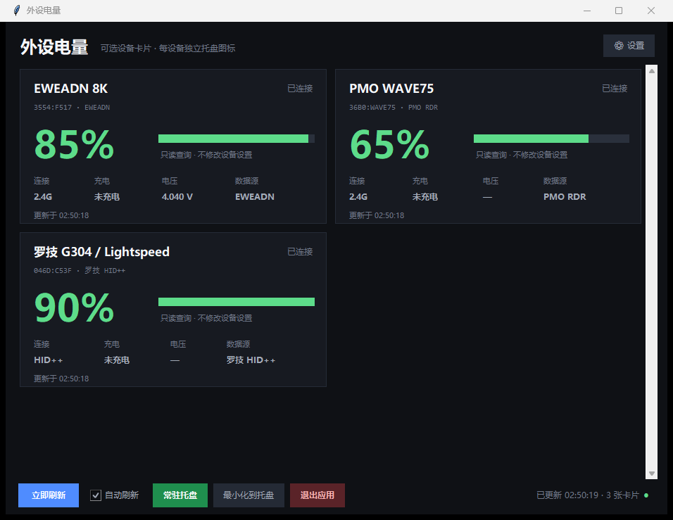

# EWEADN 8K 鼠标电量读取器

读取 **迈从 EWEADN S9 V2 Master（2.4G，VID `0x3554` / PID `0xF517`，产品名 `EWEADN 8K`）**
鼠标电量的小工具。纯 Python 标准库 + `ctypes` 调 Windows HID，**零第三方依赖**。
另外附带一个 Raw Input 事件监视器，可以看这只鼠标的按键、移动和滚轮。

> 协议参考 [`2.4G-battery-viewer`](../2.4G-battery-viewer) 的方法论，
> 针对这台鼠标重新逆向并用真机回包验证。设备不在支持列表里的鼠标请勿直接套用。



## 已验证的读数（真机抓包）

| 项目 | 值 |
|---|---|
| 设备 | `EWEADN 8K`，`3554:F517`，厂商字符串 `Compx` |
| 协议接口 | HID 顶层集合 `usage page 0xFF02 / usage 0x0002`，`col05` |
| 报告 | Input / Output 均 17 字节（Report ID `0x08` + 16 字节报文） |
| 查询电量 | 发送命令 `0x04` |
| 真机回包 | `08 04 00 00 00 02 5A 00 0F D1 ... 0D` |
| 解析结果 | 电量 90%（设备自报）/ 电压 4049 mV / 未充电 |

按 E-HUB 同款电压曲线换算后，该回包显示 **87%**（UI 优先用电压算电量）。

## 快速开始

要求：Windows 10/11 + Python 3.10+（官方安装包自带 `tkinter`）。

```bat
:: 读一次
python eweadn_battery.py --once

:: 输出 JSON
python eweadn_battery.py --json

:: 每 30 秒刷新
python eweadn_battery.py --watch 30

:: 打开电量面板
python battery_panel.py
```

也可以直接双击 `启动面板.cmd`（无控制台窗口）或 `读取电量.cmd`。

命令行输出示例：

```
EWEADN 8K (3554:F517)  电量 87%（设备自报 90% · 4.049 V · 未充电）
```

## 电量面板

- 大号百分比 + 进度条，颜色随电量变化（≥60 绿 / 30–59 黄 / <30 红）
- 显示电压、充电状态、设备自报电量、更新时间
- 自动刷新（30 秒 / 60 秒 / 2 分钟 / 5 分钟），可手动刷新
- 读取在后台线程，界面不卡；关闭窗口即退出，无残留进程

## 调试工具

```bat
python debug_tool.py list          :: 列出本机 EWEADN 的所有 HID 接口
python debug_tool.py read          :: 读电量并打印原始收发报文
python debug_tool.py monitor 10    :: 监听 10 秒 Input Report
python debug_tool.py send 4        :: 发送原始命令 0x04
python debug_tool.py wake 15       :: 连续查询在线状态，确认鼠标是否醒着
```

## 协议细节

### 报文格式

请求（Output Report，Report ID `0x08`，共 17 字节）：

```
08 | cmd | 00 00 | len | payload[0..9] | 00 ... | checksum
```

- `cmd`：`0x03` 查询在线状态，`0x04` 查询电量
- `len`：payload 长度
- `checksum = (0x4D - sum(bytes[0..14])) & 0xFF`
  （等价于厂商代码里的 `0x55 - (ReportId + sum)`）

回复（Input Report，Report ID `0x08`）：

| 偏移 | 含义 |
|---|---|
| `[0]` | `0x08` Report ID（`ReadFile` 读出时带；WebHID 的 `data` 不带） |
| `[1]` | 命令字（与请求相同） |
| `[2]` | 状态：`0x00` 成功，`0x01` 不支持 / 失败 |
| `[5]` | 设备自报电量（0–100） |
| `[6]` | `1` = 正在充电 |
| `[7..8]` | 电池电压，大端，单位 mV |
| `[15]` | 校验和 |

### 电压 → 电量曲线

与 E-HUB 前端一致，按 mV 做 5% 一档的分段线性插值：

```
3050, 3420, 3480, 3540, 3600, 3660, 3720, 3760, 3800, 3840, 3880,
3920, 3940, 3960, 3980, 4000, 4020, 4040, 4060, 4080, 4110
```

`4049 mV → 87%`。设备同时会给一个自报百分比（`[5]`），电压为 0 时才用它兜底。

## 为什么和 E-HUB 显示差 1~3%？

同一时刻其实有三个口径：

| 口径 | 数值示例 | 来源 |
|---|---|---|
| 设备自报电量 | 90% | 电量回复 `[5]` 字节，设备自己的电量计 |
| 当前电压估算 | 87% | `4049 mV` 按厂商曲线即时换算 |
| E-HUB 卡片 | 89% | 官方显示层的「平滑 + 缓存」结果 |

E-HUB 的显示不是即时值：它的 `batteryHandleInit` 在 60 秒内会保持上次的显示值，
之后把变化限制在大约 `-0.014%/s ~ +0.028%/s`；另有 10 秒定时器每次最多降 1%。
设备休眠、或窗口缩到托盘导致定时器被节流时，它会继续停在旧值上。
所以 89% 通常是「之前更高、还没降下来」的显示值，87% 是当前电压的即时换算，
两者都不是硬件故障。设备自报的 90% 则是电量计的粗粒度结果。

本工具默认显示即时值（87%），面板里同时保留「设备自报 90%」作为参考。

> 实测验证：退出并重启 E-HUB 后，官方卡片显示的正是 **87%**，与本工具一致；
> 之前的 89% 是上一会话缓存 / 平滑后的旧值。

## 实现要点

1. **独立异步读句柄**：Windows 上同一 HID 句柄并发「阻塞 ReadFile + WriteFile」
   可能直接杀掉进程，所以读用一个单独的 `FILE_FLAG_OVERLAPPED` 句柄 + 事件超时。
2. **E-HUB 可以同时开着**：本工具只读状态，不写配置；实测与 E-HUB 同时访问
   `col05` 互不影响。两条通道都会收到 Input Report，按命令字过滤即可。
3. **鼠标休眠**：2.4G 鼠标静置几分钟后会休眠，dongle 仍能回 `0x03`，但 `[5] = 0`。
   此时动一下鼠标或按一下按键即可；工具会给出明确提示并自动重试。
4. **不写日志**：默认不产生任何日志文件，`--debug` 才打印原始报文。

## 监控按键 / 移动（Raw Input）

```bat
python mouse_events.py --list              :: 列出 Raw Input 设备
python mouse_events.py --seconds 20        :: 只监视 EWEADN（默认）
python mouse_events.py --stats             :: 每秒打印速率
python mouse_events.py --all --seconds 5   :: 调试：显示所有鼠标/键盘
```

输出示例（真机）：

```text
[00:10:43.424] mouse   move  dx=+40 dy=-25  (1 包)
[00:10:44.433] mouse   left   down
[00:10:44.498] mouse   left   up
[00:10:46.336] mouse   wheel  up (+120)
[00:10:50.102] key     VolumeUp   down  (scan=0x30)
```

- 能监控：左 / 右 / 中键、侧键 1/2、滚轮、横滚、相对移动 `dx/dy`，
  以及设备键盘接口上出现的按键（多媒体键、DPI 键等如果走键盘 HID 就能看到）。
- 按 VID/PID 过滤，只接收这只 EWEADN 鼠标/接收器的事件；`--all` 才显示其它设备。
- 鼠标 / 键盘顶层集合被系统独占，不能直接 `ReadFile`；这里用 Windows Raw Input
  （`WM_INPUT` + `RIDEV_INPUTSINK`），不需要驱动，也不需要管理员权限。
- 移动事件按 50 ms 聚合打印，避免 8K 回报率刷屏；`--stats` 可以看真实包速率。
- 纯厂商自定义、不映射到标准 HID 的按键（例如只在 `0xFF06/0x0002` 私有集合里上报的
  配置态数据），还需要像电量一样对私有报文做逆向；标准键鼠事件已经覆盖。

## 目录结构

| 文件 | 说明 |
|---|---|
| `eweadn_proto.py` | 协议常量、校验和、报文构造 / 解析、设备发现、`read_battery()` |
| `eweadn_battery.py` | 命令行入口（`--once` / `--json` / `--watch` / `--debug`） |
| `battery_panel.py` | Tkinter 电量面板 |
| `debug_tool.py` | 枚举 / 监听 / 发原始命令 / 唤醒检查 |
| `mouse_events.py` | Raw Input 事件监控（按键 / 移动 / 滚轮 / 键盘） |
| `hid_win.py` | 纯 ctypes 的 Windows HID 访问层（沿用 `2.4G-battery-viewer`） |
| `tests/test_proto.py` | 纯协议单元测试（不访问硬件） |

## 测试

```bat
python -m unittest discover -s tests -v
```

8 个用例覆盖：真机抓包帧的校验和、报文归一化、电量解析、电压曲线、单调性；
另外 5 个用例覆盖 Raw Input 的移动 / 按键 / 滚轮 / 键盘事件解析，共 13 个。

## 逆向过程（简述）

E-HUB 是 Electron 应用，设备页通过 WebHID 直接与 dongle 通信。它的前端 bundle
（`new-hub.eweadn.cn` 的 `main.sdk-mouse-jiangmeng` / `mouse-hid-jiangmeng-device`
chunk）里保留了完整的「匠盟」协议实现：16 字节报文、命令表、校验和、电量字段偏移
和电压曲线。按这些常量在本机 HID 接口上复现后，第一次发送 `0x04` 就拿到了
`08 04 ... 5A 00 0F D1` 的真实回包，与代码解析完全吻合。

## 限制

- 只支持 `3554:F517`（以及同协议的 EWEADN 8K 系列；其它 VID/PID 需要自行改常量）。
- 只支持 Windows（依赖 `setupapi` / `hid` / `kernel32`）。
- 接收器必须插在 USB 口上；鼠标需开机并与接收器配对。
- 不做设置写入、不改 DPI / 灯效 / 按键，只读取电量与在线状态。

## 致谢

HID 访问层 `hid_win.py` 来自 [2.4G-battery-viewer](../2.4G-battery-viewer)，
协议部分为针对本机设备的逆向结果，仅供学习与个人使用。
